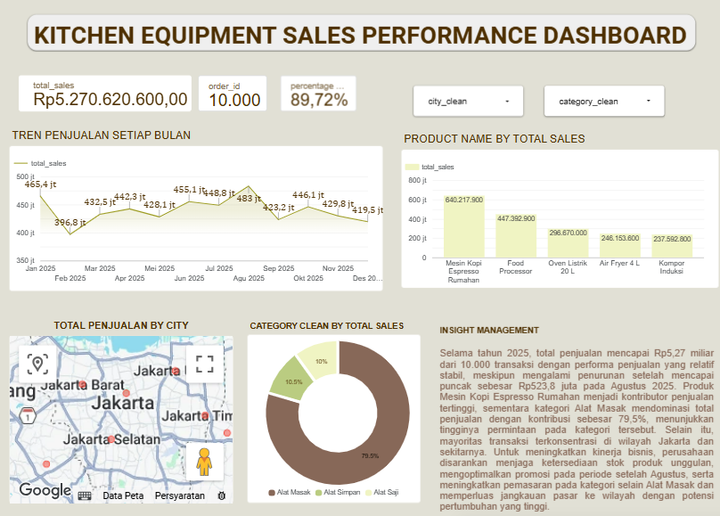

# Kitchen Equipment Sales Analysis

## Project Overview
This project analyzes kitchen equipment sales data using SQL and Looker Studio to explore sales performance, product categories, and order status.

## Tools
- **Google BigQuery (SQL):** Data querying and analysis
- **Looker Studio:** Data visualization and dashboard development

## Dashboard

[View Kitchen Equipment Sales Performance Dashboard](https://datastudio.google.com/reporting/ad5a729a-0cb9-4615-a6e0-9800897eef55)

## SQL Analysis
The SQL queries in this repository explore:
- Order and product data
- Sales performance by product category
- Completed orders and total sales
- Order status and spending categories

## Dataset
The project uses a cleaned kitchen equipment sales dataset containing order details, sales dates, product names, categories, order statuses, and sales values.

## Project Status
Dashboard development and SQL exploration have been completed. Further validation of business metrics and insights is ongoing.

